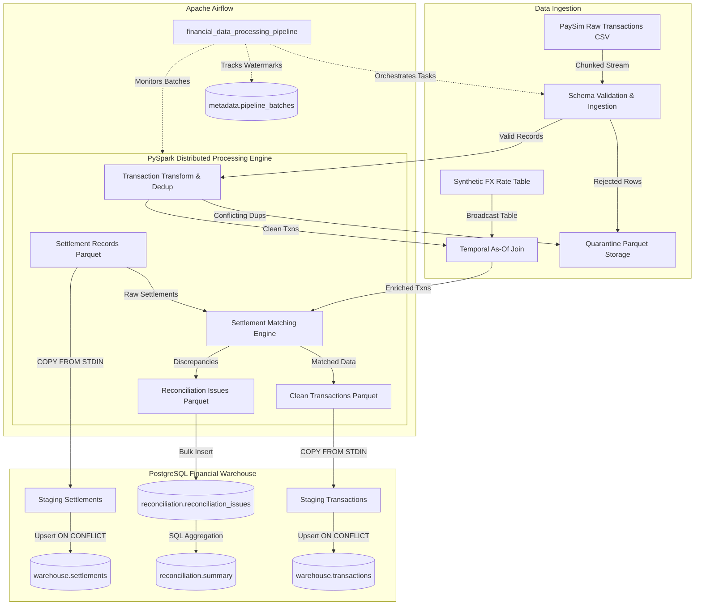

# Distributed Financial Data Processing & Reconciliation Pipeline

An enterprise-grade, distributed financial data engineering pipeline built with **PySpark**, **PostgreSQL 16**, **Apache Airflow**, and **Docker**. Ingests, validates, enriches, deduplicates, and reconciles high-volume financial transactions against settlement confirmations with full anomaly tracking.

---

## Architecture Overview



---

## Core Non-Negotiables & Engineering Principles

1. **Money Precision**: All monetary values are strictly processed using `decimal.Decimal`, PySpark `DecimalType(18,2)`, and PostgreSQL `NUMERIC(18,2)`. Floating point types are never used for currency.
2. **Explicit Schemas**: All dataframes use explicit, compiled `StructType` schemas—`inferSchema` is strictly avoided to prevent runtime type drift and performance penalties.
3. **Zero Silent Drops**: Any malformed or rejected records are routed directly to quarantine parquet storage (`data/rejected/`) preserving the raw payload, ingestion source, reason codes, batch ID, and timestamp.
4. **Idempotent Loads**: Two-phase bulk loading via PostgreSQL `COPY ... FROM STDIN` into staging tables, followed by atomic `INSERT ... ON CONFLICT DO UPDATE` into production warehouse tables. Re-running the same batch produces **0 duplicates**.
5. **Multi-Issue Anomaly Model**: A transaction can experience multiple issues simultaneously (e.g., amount mismatch, delayed settlement, missing FX). Each anomaly creates a distinct, auditable row in `reconciliation.reconciliation_issues`.

---

## Project Structure

```
distributed-financial-pipeline/
├── config/
│   └── settings.yaml            # Pipeline settings, thresholds & anomaly rates
├── dags/
│   └── financial_data_processing_pipeline.py  # Airflow orchestration DAG
├── docker/
│   └── docker-compose.yml       # PostgreSQL 16, Spark cluster, Airflow services
├── scripts/
│   └── pipeline_runner.py       # End-to-end local CLI pipeline executor
├── sql/
│   ├── staging/                 # Landing staging tables
│   ├── warehouse/               # Core normalized dimensional warehouse
│   ├── reconciliation/          # Issue tables and analytical views
│   └── metadata/                # Batch status and quarantine tables
├── src/
│   ├── analytics/               # SQL aggregation and reporting queries
│   ├── database/                # Connection pooling, schema manager, COPY loader
│   ├── generators/              # Synthetic FX rates, settlements, anomaly injector
│   ├── ingestion/               # Chunked CSV reader, schema validator, quarantine
│   ├── monitoring/              # Watermarking and incremental processing
│   ├── reconciliation/          # In-database matcher and precision/recall scoring
│   └── transformations/         # PySpark deduplication, as-of FX join, matcher
├── tests/
│   ├── unit/                    # 70+ unit tests across all individual modules
│   └── end_to_end/              # Complete pipeline integration test
├── Makefile                     # Operational make targets
└── requirements.txt             # Pinned project dependencies
```

---

## Quickstart & Usage

### 1. Environment Setup
```bash
# Set up Python virtual environment
python -m venv .venv
source .venv/bin/activate  # Or on Windows: .venv\Scripts\activate
pip install -r requirements.txt
```

### 2. Generate Synthetic Datasets & Anomalies
```bash
make data
# Or manually:
python -m src.generators.fx_rates
python -m src.generators.enrich_paysim
python -m src.generators.generate_settlements
python -m src.generators.inject_anomalies
```

### 3. Run Test Suite
```bash
make test
# Or with coverage:
pytest --cov=src -v
```

### 4. Execute Full Pipeline Locally
```bash
make pipeline
```

### 5. Launch Distributed Docker Services
```bash
make up
# Access:
# - Airflow UI: http://localhost:8081
# - Spark Master UI: http://localhost:8080
# - PostgreSQL: localhost:5432
```


